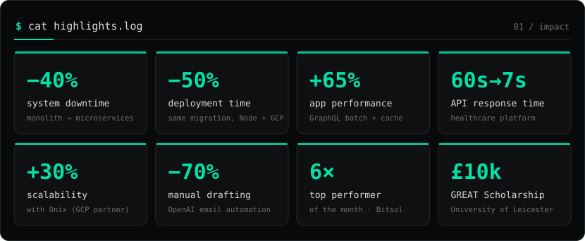
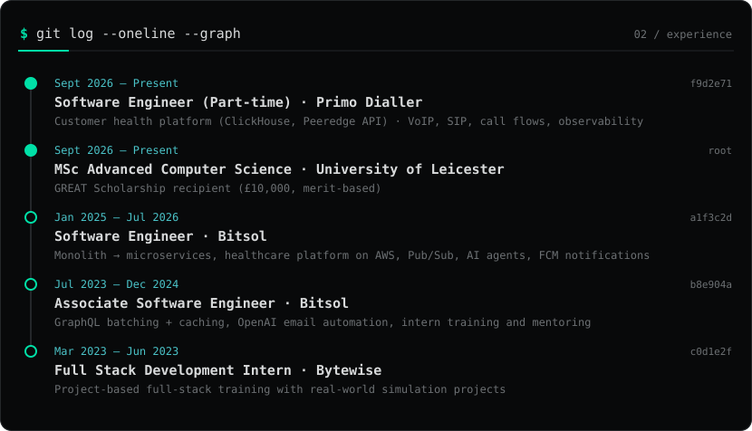
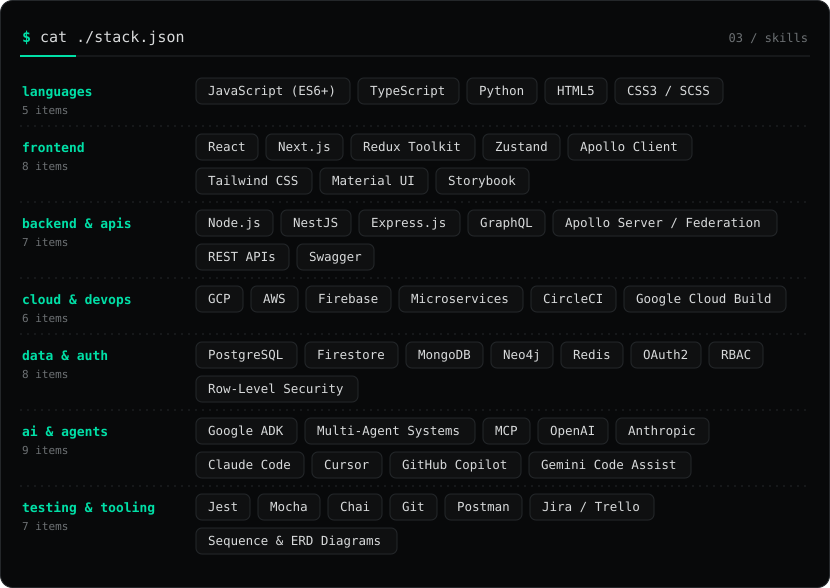
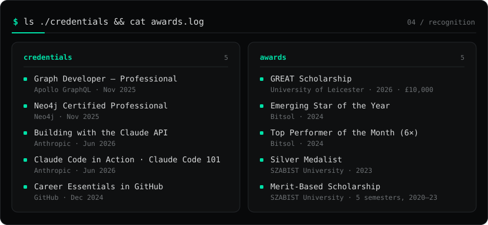

 

 

 

 

 

 

 

**Open to software engineering roles** · Leicester, UK · hybrid, remote or relocation

Projects, testimonials and the full story at **[ateeqrana.live](https://ateeqrana.live/)**

<!--
Previously listed, kept here in case you want them back:
  StackOverflow: https://stackoverflow.com/users/13228534/ateeq-rana
  HackerRank:    https://www.hackerrank.com/ateeq_rana7
  LeetCode:      https://leetcode.com/AteeqRana7/
  Codewars:      https://www.codewars.com/users/AteeqRana7
  Upwork:        https://www.upwork.com/freelancers/ateeqrana7
  Fiverr:        https://www.fiverr.com/ateeq_rana7
-->
